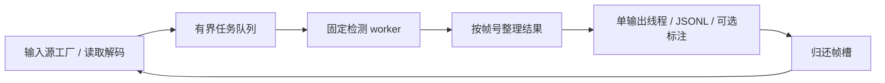

# RK3568 YOLOv8 行人检测

C++17 离线部署项目。只检测 `person`，一帧可以有多个行人。支持单张图片、图片目录及本地视频；视频完整读取、按帧号输出，队列满时阻塞读取。原有两个参考项目和模型转换脚本均未修改。

已附带现有 RK3568 模型、RKNN Runtime 2.3.2、RGA 1.10.0 和带 FFmpeg 的 AArch64 OpenCV 4.10.0。`install/cross` 是已编译链接的部署目录。主机验证结果见 [docs/VALIDATION.md](docs/VALIDATION.md)。NPU 精度、RGA 像素差异、驱动兼容性和实际性能仍需在板端验收。

## 直接部署已有安装包

把整个 `install/cross` 目录复制到 RK3568，例如 `/opt/person_detector`，保留 `lib` 内符号链接：

```bash
# 在开发机；替换板端地址，复制操作由你执行
scp -r install/cross user@BOARD:/opt/person_detector

# 在板端
/opt/person_detector/bin/person_detect --help
bash /opt/person_detector/tools/check_board.sh
/opt/person_detector/bin/person_detect \
  --input /data/people.mp4 \
  --io standard --preprocess opencv --workers 1 \
  --jsonl /data/baseline.jsonl --summary /data/baseline.json
```

模型默认从可执行文件旁的 `../model/best.rknn` 加载，无需修改绝对路径。主程序 RPATH 为 `$ORIGIN/../lib`，附带 OpenCV 库为 `$ORIGIN`。标准 C/C++ 运行库使用板端系统版本。

安装包根目录附带含多个行人的 `test.jpg`，来源为现有 Model Zoo 的 `examples/yolov8/model/bus.jpg`，未修改图像。在板端包目录可直接做单图检查：

```bash
cd /opt/person_detector
mkdir -p results
./bin/person_detect --input ./test.jpg --model ./model/best.rknn \
  --workers 1 --io standard --preprocess opencv \
  --jsonl results/image.jsonl --annotated results/images \
  --summary results/image_stats.json
```

`--input` 必须指向板端已经存在的文件。使用其他图片或视频前先传输素材，再填写实际路径；示例中的 `/data/people.mp4` 需自行准备。

安装包还附带 `test.mp4`，来自下载的 [OpenCV 官方行人示例 vtest.avi](https://github.com/opencv/opencv/blob/4.10.0/samples/data/vtest.avi)。截取前 20 秒并转为 MPEG-4 MP4，768×576、10 FPS、200 帧，约 2.88 MiB。可以直接生成标注视频：

```bash
cd /opt/person_detector
mkdir -p results
./bin/person_detect --input ./test.mp4 --model ./model/best.rknn \
  --workers 1 --io standard --preprocess opencv \
  --jsonl results/video.jsonl --annotated results/marked.mp4 \
  --summary results/video_stats.json
python3 tools/check_jsonl.py results/video.jsonl --frames 200
```

把 `results/marked.mp4` 拷回电脑播放，即可查看板端实际模型的检测效果。

先用单 worker、OpenCV、普通 API 验证结果。随后运行自动路径或性能矩阵：

```bash
/opt/person_detector/bin/person_detect \
  --input /data/people.mp4 --workers 2 --io auto --preprocess auto \
  --jsonl /data/auto.jsonl --summary /data/auto.json
```

显式选择 `rga` 或 `bound` 时，兼容性失败会返回错误。`auto` 会记录回退原因和实际工作模式。自动输入选择在启动阶段先验证普通 API，再验证绑定输入；运行中的推理错误仍会中止任务。

## 构建

```bash
# 开发机 AArch64 Release 交叉编译；默认使用附带的 AArch64 OpenCV
bash scripts/build.sh cross
python3 scripts/check_package.py install/cross

# RK3568 板端原生 Release 编译
bash scripts/build.sh native

# 覆盖工具链或依赖路径
CROSS_COMPILE=/path/to/aarch64-none-linux-gnu- \
OpenCV_DIR=/path/to/opencv/lib/cmake/opencv4 \
RKNN_ROOT=/path/to/rknn RGA_ROOT=/path/to/rga \
bash scripts/build.sh cross
```

`RKNN_ROOT` 和 `RGA_ROOT` 应包含 `include/`、`lib/`。另外可覆盖 `BUILD_DIR`、`INSTALL_DIR`、`JOBS`，或给脚本追加 CMake 参数。禁用 RGA：`PERSON_ENABLE_RGA=OFF bash scripts/build.sh cross`。

板端原生构建需要 CMake ≥3.16、支持 C++17 的编译器及 pthread。附带二进制由 GCC 9.4 AArch64 工具链构建；若板端 `libstdc++` 或 glibc 不兼容，请使用板端工具链重新编译。检查命令见 [docs/DEPLOYMENT.md](docs/DEPLOYMENT.md)。

依赖不存在或需要其他视频编码格式时，可使用系统带 FFmpeg 的 OpenCV，或重建独立依赖：

```bash
# 编译 OpenCV 4.10.0 + FFmpeg 4.4.5，不修改系统安装
bash scripts/build_opencv.sh cross
# 板端同样可以使用 native；主机集成测试使用 host
```

附带 FFmpeg 精简构建支持 H.264、MPEG-4、MJPEG 解码，以及 MOV/MP4、AVI 容器；标注视频编码为 MPEG-4。HEVC、MPEG-TS、其他编码格式需切换到具备对应编解码器的 OpenCV/FFmpeg。没有摄像头、RTSP 或 MPP 专用编解码入口。

## 输入与输出

```bash
# 图片目录：按文件路径排序，不递归子目录
install/cross/bin/person_detect --input /data/images \
  --jsonl images.jsonl --annotated marked_images

# 单张图片，默认阈值 0.25 / 0.45
install/cross/bin/person_detect --input /data/person.jpg --conf 0.25 --nms 0.45

# 需要标注视频时显式开启编码
install/cross/bin/person_detect --input /data/people.mp4 \
  --annotated marked.mp4 --jsonl video.jsonl --summary video_stats.json
```

默认一个 worker、独立预热三次、不开 GUI、不逐帧打印、不编码标注视频。`--inflight` 默认 `2×workers+2`，可覆盖。`--warmup 0` 可用于功能排错。输出父目录需存在，标注图片目录会自动创建；输出文件采用覆盖写入。

JSONL 每帧一条，无检测时 `detections` 为空：

```json
{"frame_id":0,"source":"/data/person.jpg","timestamp_ms":0,"detections":[{"class_id":0,"label":"person","score":0.91,"box":[10,20,100,200]}],"preprocess":"opencv","io":"standard","timing_ms":{"read":1,"queue":0.1,"preprocess":1,"inference":10,"postprocess":0.5,"result_wait":0.1,"output":0.2,"latency":12.9}}
```

框为原图 `x1,y1,x2,y2` 浮点坐标，裁剪到原图范围。图片时间戳为 0；视频使用解码器时间戳，缺失时按帧号和 FPS 推算。`SIGINT/SIGTERM` 会唤醒等待线程、等待正在执行的有限调用结束并返回非零；失败或中断时 JSONL 可能只有已输出前缀，应以退出状态判断任务是否完整。

## 架构与优化



每个 worker 独占 RKNN context、预处理器、输入/输出缓冲及后处理工作区。模型只从文件加载一次，其他 context 用 `rknn_dup_context()` 共享权重。RK3568 不调用 core mask 接口。自动模式的兼容性探测使用临时复制 context，随后释放；正式 worker 数仍固定。

输入源、预处理器、推理引擎分别通过工厂选择，硬件逻辑集中在 [src/engine.cpp](src/engine.cpp) 和 [src/preprocess.cpp](src/preprocess.cpp)。可独立测试的队列、排序、取消逻辑位于 [include/person/pipeline.hpp](include/person/pipeline.hpp)。只有有限帧槽能进入流水线；即便首帧很慢或输出很慢，乱序结果也不会无限积压，检测线程不会因为等待排序而阻塞提交首帧。

预处理匹配当前行人 Python 验证脚本：等比例缩放、Python ties-to-even 舍入、居中黑色填充、BGR→RGB。坐标还原使用 nominal scale 和浮点半补边，与 Python helper 一致。普通路径提交 UINT8 NHWC、`pass_through=0`，由 Runtime 执行已配置的归一化。

启动时检查单输入、416×416、INT8 和九输出：每组为 64 通道 DFL、1 通道人概率、1 通道 score_sum，网格为 52/26/13。单类别 score_sum 不增加分类信息，后处理只读取分类头筛选。分类头已在图中执行 sigmoid；先在 INT8 域筛选，再对候选点做稳定 DFL softmax 和单类别 NMS。输出数组按正确索引预分配，使用后调用 `rknn_outputs_release()`。

绑定路径查询 native NHWC 属性，检查 `w_stride/size_with_stride`，分配 RKNN 输入内存。输出仍使用预分配普通 API，保证逻辑 NCHW 布局。RGA 使用同步 resize/颜色转换，支持直接写绑定输入 FD；补边后执行 TO_DEVICE 同步，RGA 写入后执行 FROM_DEVICE 同步。未关闭 Runtime 的输入缓存刷新。RGA2 的 stride/矩形限制或驱动不支持时，自动路径退回 OpenCV，显式路径报错。RGA 与 OpenCV 插值并非保证逐像素一致，需用实际检测结果验收。

## 验证与性能

```bash
# Python 使用已有 rknn conda 环境；纯 C++ 测试无需 NPU/OpenCV
bash scripts/host_tests.sh

# 主机完整 I/O 测试需 host 架构 OpenCV；模拟 Runtime 只用于逻辑验证
HOST_OPENCV_DIR=/path/to/host/opencv/lib/cmake/opencv4 bash scripts/host_tests.sh

# 板端导出首帧同一组 RKNN 输出
install/cross/bin/person_detect --input /data/person.jpg \
  --io standard --preprocess opencv --dump-first dump --jsonl reference.jsonl

# 把 dump 和 JSONL 拷回开发机，用同一原始张量比较 NumPy/C++
conda run -n rknn python scripts/reference_decode.py \
  --decoder build/host-tests/decode_dump --dump dump --jsonl reference.jsonl

python3 scripts/check_jsonl.py video.jsonl --frames 1000
python3 scripts/compare_jsonl.py baseline.jsonl optimized.jsonl

# 在 RK3568 上跑 1/2/3/4 worker、四组输入/预处理路径，默认每组重复三次
python3 /opt/person_detector/tools/benchmark.py --binary /opt/person_detector/bin/person_detect \
  --model /opt/person_detector/model/best.rknn --input /data/people.mp4 \
  --annotated video --out /data/benchmark_results
```

测速先完成独立预热与兼容性探测。报告实际完成帧数、检测吞吐、包含 JSONL flush 和视频编码排空的端到端时间、分阶段均值/p50/p95、RSS 高水位和队列峰值。检测吞吐使用首个检测开始到最后检测结束的墙钟区间，包含读取/输出回压造成的停顿；不会把各线程 FPS 简单相加。

时延统计采用固定容量直方图，1 ms 分辨率，60 秒封顶，避免长期视频不断增长统计内存。每帧 JSONL 的 output/latency 在写出时间字段之前采样；汇总在整条记录写完后采样。总时间包含最终输出排空，不包含模型初始化、预热和 summary 文件本身的写入。RSS 包含模型初始化高水位。

这里的“写盘排空”指编码器关闭和用户态流 flush，不执行全盘 `sync/fsync`；如果验收需要持久化到存储介质，应单独测量同步写盘成本。

性能脚本仅在 AArch64 板端运行。它保存模型/输入 SHA256、日志、每次结果和摘要；与单 worker 普通路径比较帧数和检测结果，只有全部比较通过且三次 FPS 中位数高出基线 2% 的配置才替代基线推荐。默认比较要求每帧行人数相同、匹配框 IoU ≥0.98、分数差 ≤0.02，严格比较可设置 `--score-tolerance 0 --iou 0.99999`。正式推荐仍需代表性数据、长时间运行和热稳定条件；当前没有板端 FPS 承诺。
